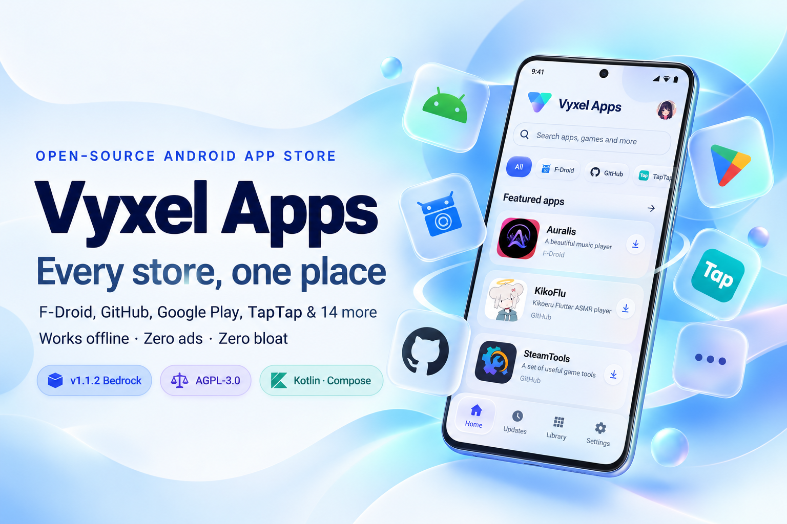
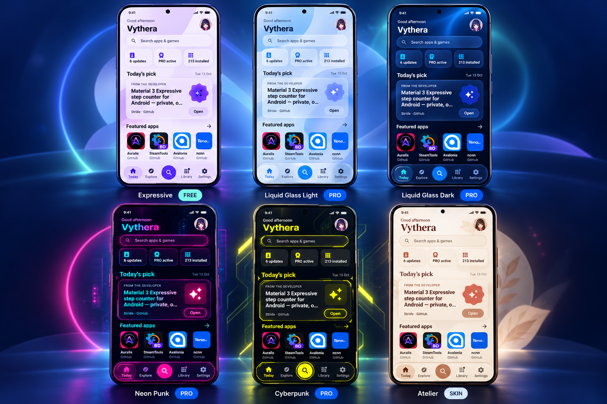
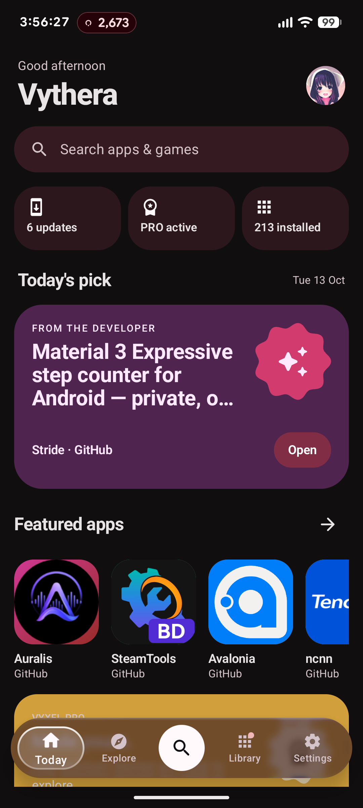
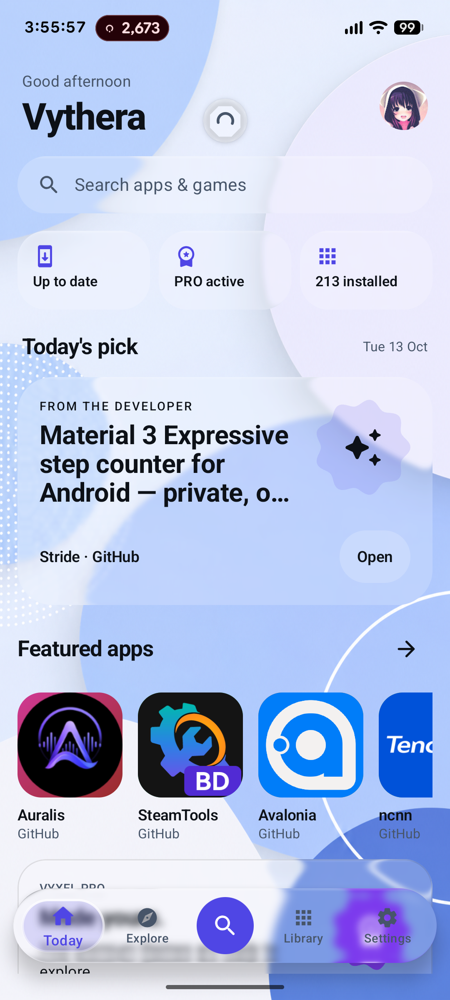
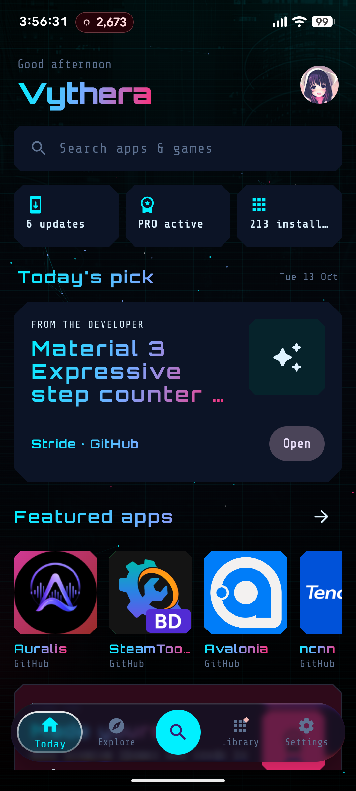
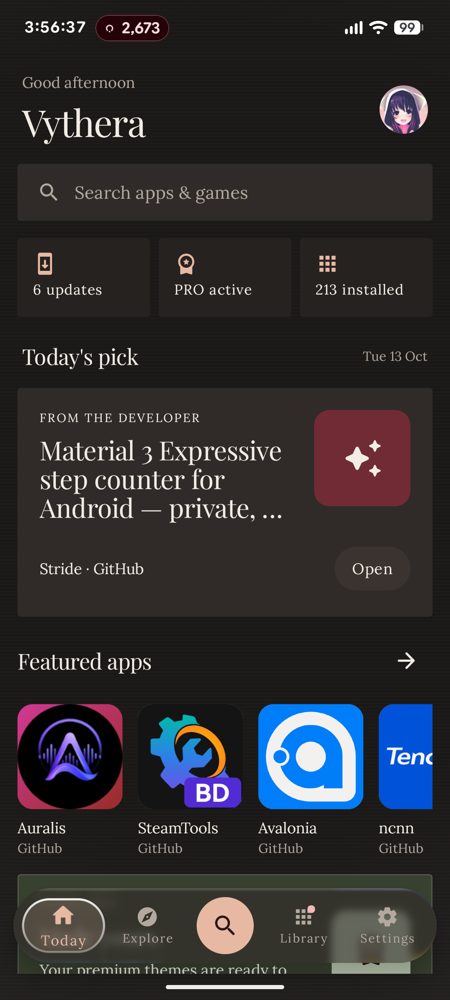
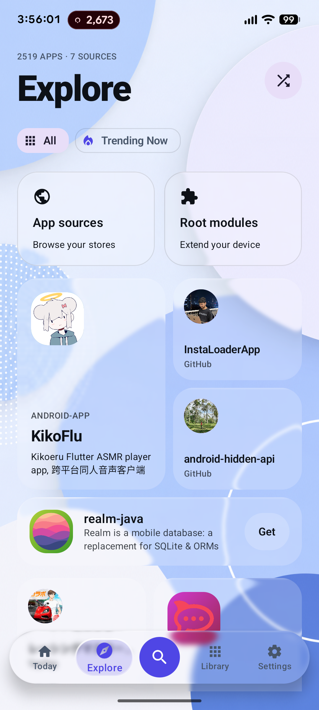
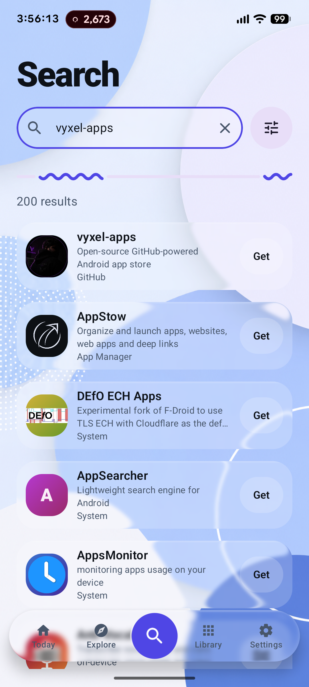
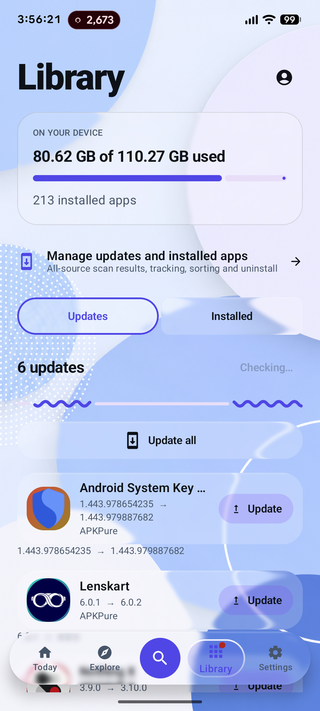
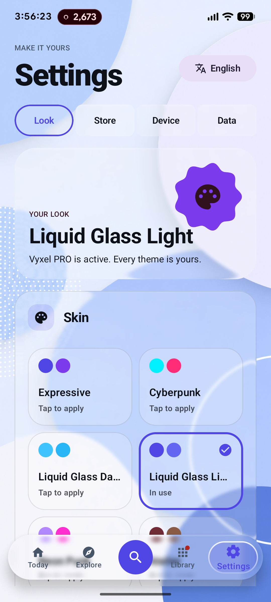

<a id="top"></a>
<div align="center">

<picture>
  <source media="(prefers-color-scheme: dark)" srcset="docs/readme/hero-dark.png">
  
</picture>

[](https://github.com/NikhilKain/vyxel-apps/releases)
[](LICENSE)
[](https://github.com/NikhilKain/vyxel-apps/stargazers)
[](#installation)

[**⬇ Download APK**](https://github.com/NikhilKain/vyxel-apps/releases/latest) &nbsp;·&nbsp; [**🌐 Website**](https://NikhilKain.github.io/vyxel-apps/) &nbsp;·&nbsp; [**💬 Telegram**](https://t.me/vyxelapps/1) &nbsp;·&nbsp; [**🐛 Report a bug**](https://github.com/NikhilKain/vyxel-apps/issues)

<sub>[What's new](#whats-new) · [Features](#features) · [Themes](#themes) · [Screenshots](#screenshots) · [Install](#installation) · [Open core](#open-core) · [Support](#support)</sub>

</div>

<br/>


> [!IMPORTANT]
> **This repository is the only official source of Vyxel Apps.** APKs from any other website,
> Telegram channel or mirror are unofficial and may be tampered with. Always verify the signature.


<a id="whats-new"></a>
## 🆕 New in v1.1.2 — Bedrock

- **📴 Works offline.** An offline catalogue keeps every source's app list on your phone, so browsing and search work with no connection and answer before the network does. It syncs once a day, incrementally, on Wi-Fi by default, within a storage limit you choose, and never spends the GitHub quota you need.
- **🧰 Developer repos.** The F-Droid repositories Droid-ify and Neo Store ship with — Bitwarden, NewPipe, microG, Guardian Project, Molly, Session, Threema and more — with builds signed by the projects themselves.
- **🎮 TapTap.** Game charts and search, installed from Google Play or Aptoide when a verified build exists.
- **⬇️ Download APK** on every app page, and installed apps, updates and tracked apps now open to a real file instead of "No APK".
- **A new icon**, and the launch crash some phones hit on 1.1.1 fixed for real.

[Full release notes →](https://github.com/NikhilKain/vyxel-apps/releases)


<a id="features"></a>
## ✨ Features


<table>
<tr>
<td width="50%" valign="top">

**🔍 18 sources, one store**<br/>
F-Droid, IzzyOnDroid, the developers' own F-Droid repos, GitHub, GitLab, Codeberg, Google Play, Aptoide, TapTap, Aurora OSS, APKPure, patched apps, Flathub and WinGet, plus four root-module repositories — searched and merged into a single feed.

**📴 Works offline**<br/>
Every source's app list is kept on the phone. Browse and search with no connection; online, search answers from disk before the network does.

**🗂 17 curated categories**<br/>
Games, Productivity, Security, Dev Tools, Media, Finance and more, plus smart sections like Trending and Newly Launched.

**🛡 Signature verification**<br/>
Every downloaded APK is checked against the installed app's signing certificate before install — a hijacked repo or redirected release can't silently overwrite what's on your phone.

**🥷 Silent installs via Shizuku**<br/>
Skip the system install confirmation screen entirely when Shizuku is running.

**🛡 Trust Score**<br/>
A 0–100 score based on stars, activity, releases and forks.

**🔔 Background update monitoring**<br/>
WorkManager checks installed apps against every source and notifies you of updates.

</td>
<td width="50%" valign="top">

**📱 Home screen widget**<br/>
App of the Day plus your pending update count, refreshed every 30 minutes.

**⬇️ Download APK**<br/>
Save any app's file to Downloads instead of installing it — split installs are saved as the whole set.

**📸 Auto-extracted screenshots**<br/>
Pulled straight from each repo's README.

**🔄 Install history & rollback**<br/>
Roll back to a previous version straight from your install history.

**⭐ GitHub starred repos sync**<br/>
Sync your stars into favourites.

**🌍 16 languages**<br/>
English, Hindi, Spanish, French, German, Japanese, Portuguese, Italian, Russian, Chinese, Korean, Arabic, Dutch, Turkish, Polish, Swedish.

**📢 In-app announcements**<br/>
Dismissible banners for giveaways, releases and community updates.

</td>
</tr>
</table>


<a id="themes"></a>
## 🎨 Themes



<a id="liquid-glass-pro"></a>
### 💎 Liquid Glass Pro <sub>(optional)</sub>

Four premium themes — **Liquid Glass Dark**, **Liquid Glass Light**, **Neon Punk** and **Cyberpunk** — built on real-time backdrop blur, all unlocked with a single licence key. A free 30-second preview is available before you buy.

The app is fully usable without it — see [Open core](#open-core) for exactly what is and isn't included.

<div align="center">

[](https://narzo7.gumroad.com/l/suayy)

</div>


<a id="screenshots"></a>
## 📱 Screenshots

<div align="center">

<table>
<tr>
<td align="center"><br/><sub><b>Today</b> · Expressive</sub></td>
<td align="center"><br/><sub><b>Today</b> · Liquid Glass Light</sub></td>
<td align="center"><br/><sub><b>Today</b> · Cyberpunk</sub></td>
<td align="center"><br/><sub><b>Today</b> · Atelier</sub></td>
</tr>
<tr>
<td align="center"><br/><sub><b>Explore</b></sub></td>
<td align="center"><br/><sub><b>Search</b></sub></td>
<td align="center"><br/><sub><b>Library</b></sub></td>
<td align="center"><br/><sub><b>Settings</b> · skins</sub></td>
</tr>
</table>

</div>


<a id="installation"></a>
## 📥 Installation

1. Download the latest APK from [Releases](https://github.com/NikhilKain/vyxel-apps/releases/latest).
2. On your Android device: **Settings → Apps → Special access → Install unknown apps** → allow your browser or file manager.
3. Tap the downloaded APK to install.

> [!TIP]
> Install [Shizuku](https://shizuku.rikka.app/) for silent, confirmation-free installs of every app you update through Vyxel Apps.

<details>
<summary><b>🔧 Building from source</b></summary>
<br/>

```bash
git clone https://github.com/NikhilKain/vyxel-apps.git
cd vyxel-apps
```

Open the project in Android Studio (JDK 17, compileSdk 37, targetSdk 36, minSdk 26). It builds and runs out of the box — the following `local.properties` keys are all **optional** and only needed to reproduce specific production behaviour:

| Key | Purpose | If omitted |
|---|---|---|
| `signing.storeFile` / `storePassword` / `keyAlias` / `keyPassword` | Release signing | Unsigned release APK |
| `gumroad.product.id` | Liquid Glass Pro licence verification | Verification disabled — Pro themes stay locked |
| `lg.hmac.secret` / `lg.script.url` | Liquid Glass licence signing endpoint | N/A in forks |

Everything else — the six-source scanner, Trust Score, comparison mode, widget and free themes — works fully without any secrets configured.

</details>

<a id="open-core"></a>
## 🧩 Open core

Vyxel Apps is **open core**. Everything that makes it an app store is open source under AGPL-3.0; a small optional visual pack is not.

<table>
<tr>
<td width="50%" valign="top">

**✅ Open source**

- All 14 sources and the search, ranking and merge engine
- Downloads, signature verification, Shizuku installs
- Update scanning, rollback and install history
- The Modules screen (Magisk, Zygisk, LSPosed, KernelSU)
- Both interfaces — Classic and Expressive
- Trust Score, comparison, backup/restore
- 16 languages

</td>
<td width="50%" valign="top">

**💎 Paid build only**

- The four **Liquid Glass Pro** themes and their real-time blur rendering
- The licence verification and entitlement service

</td>
</tr>
</table>

No feature that affects finding, installing, updating or removing an app is behind the paywall. The paid part is cosmetic, and it is what funds the rest.

The open core is this repository. Grab the **Source code** archive attached to any [release](https://github.com/NikhilKain/vyxel-apps/releases), or clone `main`. Source updates land here every few releases, so `main` can be a little behind the newest APK.

<a id="tech-stack"></a>
## 🛠 Tech stack

- [Kotlin](https://kotlinlang.org/) + [Jetpack Compose](https://developer.android.com/jetpack/compose) + [Material 3](https://m3.material.io/)
- [Retrofit](https://square.github.io/retrofit/) + [OkHttp](https://square.github.io/okhttp/) — GitHub / GitLab / F-Droid / IzzyOnDroid / APKPure / Aptoide clients
- [Coil](https://coil-kt.github.io/coil/) — image loading
- [WorkManager](https://developer.android.com/topic/libraries/architecture/workmanager) — background update checks and the daily offline sync
- SQLite with FTS4 — the offline catalogue and its instant search
- [Shizuku](https://shizuku.rikka.app/) — silent installs without root
- [AndroidX Security Crypto](https://developer.android.com/jetpack/androidx/releases/security) — encrypted storage for tokens and licence keys
- [Backdrop](https://github.com/Kyant0/Backdrop) — real-time blur for the Liquid Glass Pro themes

<a id="contributing"></a>
## 🤝 Contributing

Contributions are welcome! Open an issue first to discuss what you'd like to change.

1. Fork the repo
2. Create a feature branch (`git checkout -b feature/cool-thing`)
3. Commit your changes (`git commit -m 'Add cool thing'`)
4. Push to the branch (`git push origin feature/cool-thing`)
5. Open a pull request

<a id="support"></a>
## 💖 Support

If Vyxel Apps is useful to you:

- ⭐ Star this repo
- 💎 Grab [Liquid Glass Pro](https://narzo7.gumroad.com/l/suayy) — it's the main thing that funds ongoing development
- 🐦 Share it with your friends
- 🐛 Report bugs in [Issues](https://github.com/NikhilKain/vyxel-apps/issues)
- 📝 Send feedback with the in-app feedback button

**App support:** https://t.me/vyxelapps/1 &nbsp;·&nbsp; **Privacy policy:** [nikhilkain.github.io/vyxel-apps/privacy-policy.html](https://nikhilkain.github.io/vyxel-apps/privacy-policy.html)

### ☕ Buy me a coffee

Hey! 👋 I'm Nikhil, an indie Android developer building this project in my free time — making apps from GitHub, GitLab, F-Droid and other developer-first sources easier to discover, install and manage on Android, while keeping everything open, fast and user-friendly.

Every contribution goes directly toward new features, bug fixes, performance improvements and long-term development.

<div align="center">

[](https://narzo7.gumroad.com/l/nhlevz)

*Thank you for supporting independent open-source development ❤️*

</div>

## 📄 License

[AGPL-3.0](LICENSE)

<div align="center">


Made with ❤️ for the community by Vythera

[⬆ Back to top](#top)

</div>
